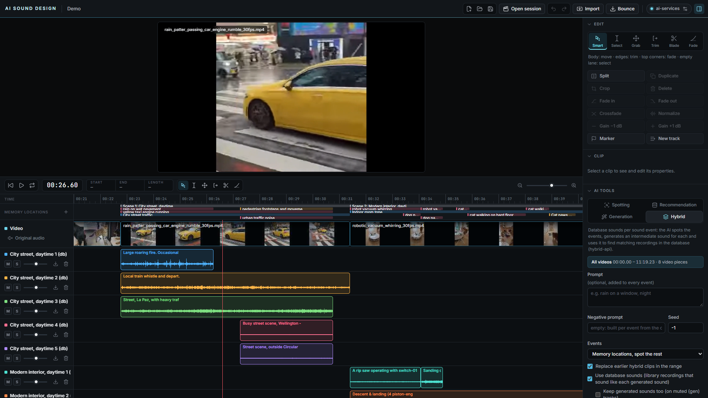

# AI Sound Design – Web UI

A browser app for the [ai-services](https://github.com/ai-sound-design/ai-services) that works
without Pro Tools. It can open whole Pro Tools sessions (`.ptx`), combines the basics of a DAW with the
four modes of the [Pro Tools plugin](https://github.com/ai-sound-design/ai-protools-aax), and runs as
one more container next to the backend:

- **Spotting**: the AI finds the sound events in the picture
- **Recommendation**: sounds from the database
- **Generation**: AI-generated sound
- **Hybrid**: database sounds found via AI spotting and generated intermediate sounds



## Quick start

Two ways to run it:

### As a container next to the ai-services

```bash
cp .env.example .env        # SESSIONS_DIR: the folder with your Pro Tools sessions
docker compose up -d --build
# http://localhost:8030
```

The image holds the built frontend and the session server (FastAPI + ffmpeg). It joins the Docker
network of the ai-services compose project and reaches the services by their names, so nothing else
needs configuring when both run on the same machine. `.env` sets the sessions folder (mounted
read-only), the port, the network name if the backend runs under another compose project name, and
the service URLs for a GPU machine on the LAN.

### For development

```bash
npm install
npm run server:setup   # once: Python venv for server/ (needs Python 3.12 and ffmpeg on the PATH)
npm run server         # http://localhost:8030, the session server
npm run dev            # http://localhost:5173, the frontend (proxies /api and /svc)
```

On macOS/Linux use `server/.venv/bin/python` instead of `.venv/Scripts/python` in the two scripts.
The server shows the folders in `SESSIONS_DIRS` (several, separated by `;`), e.g.
`SESSIONS_DIRS="D:/Projects;E:/Archive" npm run server`.

The app talks to the **ai-services**; the status button at the top right (⚙) opens their
addresses with a Test button each. For a look at the interface without a GPU server, `?mock=1` in
the URL simulates all four services in the browser with synthetic sounds (a developer switch, not
remembered). Opening a Pro Tools session always needs the session server.

### With the real ai-services

```bash
# in the ai-services repository (needs an NVIDIA GPU)
docker compose up -d
```

In the container the service URLs come from `.env`; the dev server forwards the `/svc/…` paths,
because `spotting-api`, `hybrid-api` and the generation gateway send no CORS headers:

| Path in the app    | Variable         | Default                 |
|--------------------|------------------|-------------------------|
| `/svc/spotting`    | `SPOTTING_URL`   | `http://localhost:8003` |
| `/svc/search`      | `SEARCH_URL`     | `http://localhost:8002` |
| `/svc/generation`  | `GENERATION_URL` | `http://localhost:8010` (the gateway; the bare model answers on 8000) |
| `/svc/hybrid`      | `HYBRID_URL`     | `http://localhost:8004` |
| `/api`             | `SERVER_URL`     | `http://localhost:8030` (the session server, dev only) |

Every service has a **Test** button in the settings (`GET /health`), the session server too.

## Usage

### Pro Tools sessions

**Open session** lists the session folders the server shows and opens a `.ptx` as the project:
every audio track with its clips (stereo and multichannel clips merged from their channel lanes),
the video track, and the memory locations as markers; a marker whose comment starts with
`foley:`, `sfx:`, `ambience:`, … (as the plugin writes them) gets that category. The clip names,
positions, source in-points and lengths are sample-exact; the session's sample rate, timecode rate
and Pro Tools version are shown next to the project name, and the timecode rate is taken over for
the AI requests. Audio tracks without clips are hidden unless the box in the dialog is ticked;
aux, master, VCA and folder tracks are not shown.

The media stays where it is: the server streams the video (an H.264 proxy is made for codecs the
browser cannot play, such as ProRes), serves the waveform peaks of every file, and cuts the pieces
of audio that playback needs around the playhead, so a feature-length session does not have to fit
into the browser's memory. Pieces of the session video for the AI services are cut on the server
with ffmpeg instead of ffmpeg.wasm.

What the reader does not take from the session yet: fades, clip gain, mute and automation, tempo
maps (clips on tick-based tracks are placed at 120 bpm), clip groups, and alternate playlists (they
are read but not shown). Sessions saved by Pro Tools 2025 and 2026 were tested; older `.ptx`
files should read as well, Pro Tools Cloud sessions (`.ptpx`) do not.

The reader (`server/ptsession/`) is a pure-Python implementation of the session file format,
following what [libptformat](https://github.com/zamaudio/ptformat) established and extended for
the track list with track types, video regions and video clips, memory locations with comments
and colours, and the per-channel clip lanes. `python -m ptsession <file.ptx>` prints what it finds;
`python tests/compare_ptftool.py` cross-checks the clip placements against `ptftool`.

### Project

**New / Open / Save** at the top (`Ctrl+S`, `Ctrl+O`). A project is a single `.asd` file (a ZIP)
with `project.json` (timeline, tracks, clips, memory locations), dropped videos and every generated
or imported sound as WAV, so a project can be handed on as a whole. Media of a Pro Tools session is
not copied: the project remembers the session and the files, and the server resolves them again
when the project is opened. A `.asd` file can also be dropped onto the window. A ● next to the project name marks unsaved changes, and the browser
asks before the tab is closed.

### Layout

The **Tools** panel on the right runs the full height next to the video and the timeline and can be
hidden with “◧ Tools”. Its sections collapse individually:

- **Edit**: tool palette and edit actions
- **Clip**: inspector for the selected clip (name, position, clip gain, fade lengths, video link)
- **AI tools**: the four modes
- **Jobs**: progress and errors of the AI requests

### Edit tools

| Tool | Key | What it does |
|------|-----|--------------|
| Smart | `1` | Clip body: move · clip edges: trim · top corners of audio clips: fade · empty lane: select |
| Select | `2` | Drag anywhere, also across clips, to select a range |
| Grab | `3` | Move clips (audio clips also to other tracks) |
| Trim | `4` | Drag the nearer clip edge |
| Blade | `5` | Click a clip to split it there |
| Fade | `6` | Drag in the left half of an audio clip for a fade-in, in the right half for a fade-out |

Moving and trimming snap to the playhead, the selection, markers and clip edges; hold `Alt` to
move freely. Video clips never overlap on the video track. Generated audio clips (⛓) follow their
video.

### Edit actions and shortcuts

| Action | Key |
|--------|-----|
| Play / stop (with a selection only the selection) | `Space` |
| Loop the selection | `L` |
| Return to start | `Enter` / `Home` |
| Split at the playhead (selected clip, else all clips under it) | `B`, `Ctrl+E` |
| Duplicate the selected clip | `Ctrl+D` |
| Delete the selected clip | `Del` |
| Crop clips to the selection | `Ctrl+T` |
| Fade in / fade out (to the selection edge, else 0.5 s) | `G` / `H` |
| Crossfade adjacent clips within the selection | `F` |
| Normalize (clip gain to −1 dBFS) | `N` |
| Clip gain −1 / +1 dB | `[` / `]` |
| Memory location (a range with a selection) | `M`, numpad `Enter` |
| Undo / redo | `Ctrl+Z` / `Ctrl+Shift+Z` |
| Zoom | `+`/`−` (or `T`/`R`), `Ctrl` + mouse wheel |
| Clear selection | `Esc` |

Fade and gain actions apply to the selected audio clip, or else to all audio clips touched by the
selection. Tracks have mute, solo, volume, rename (double-click), WAV export and delete.
**Bounce** exports the mix as WAV, only the selected range if there is a selection.

### AI tools

As in the plugin, every AI tool works on a **range**: the selection, else the selected clip, else all
videos. Every video clip beneath it is sent on its own. If a piece does not cover the whole clip, the
app cuts it out (downscaled, no audio, H.264), as the plugin does with ffmpeg: on the server for
session videos, with **ffmpeg.wasm** in the browser for dropped files (it loads on the first cut).
The options follow the current plugin; **Stop** ends a run after the current request, and what was
placed stays.

| Mode | Service | What it does |
|------|---------|--------------|
| **Spotting** | `POST /spot`, `POST /scenes` | *Detect scenes* groups the clips into scenes (one place, one stretch of time) and adds a memory location `Scene n: name` per scene, which Hybrid uses. *Detect sound events* places a memory location per event, with the kind and description in the comment; the *kinds* (ambience, foley, SFX, music, dialogue) are told to the model and other events are dropped. *Entire track* spots the whole video track. Optionally one memory location per clip boundary. |
| **Recommendation** | `POST /search/sounds`, `POST /search/by_audio` | *From video* searches with the video under the range and the text. *From sound* searches with the audio under the selection (the selected clip, else all audible tracks), so a sound can be swapped for archive recordings of its kind. *From sketch* takes the clips under the selection as a sketch of how the sound runs and the text as what it is. Results name the matched stretch of each recording; preview and import take that stretch. *Cut imports to the selection* trims the clip to the range and keeps the rest as handles for the Trim tool, *Keep handles* fetches the handle length from the settings before and after the stretch, *Auto fade* gives the clip the fades from the settings, outside or inside the range. Libraries come from the service. |
| **Generation** | `POST /generate` (gateway) | *V2A* generates sound for each video piece from picture and prompt; *T2A* from the prompt alone, as long as the selection (*Auto*) or a fixed length from the list the service accepts. An empty negative prompt sends the plugin's standard list. Pieces shorter than the minimum are made from that much video around them and trimmed back; pieces longer than the maximum are split. Results land on the chosen track (default “Generation”) as `<clip name> AI`; the seed is in the job's result. |
| **Hybrid** | `POST /hybrid`, `POST /hybrid/scenes` | One generated sound per sound event, placed at the event. *Events*: the backend spots everything, or the memory locations in the range are the events and clips without are spotted (or skipped). Scenes come from the session's `Scene n:` markers or are detected and written as markers. *Replace earlier hybrid clips* clears the range on every `(gen)`/`(db)` track first. *Use database sounds* also fetches library recordings that sound like each generated sound and places them instead, on the scene's `(db)` tracks (the generated sound stays where nothing matched; *Keep generated sounds* places it too, muted, on `(gen)` tracks). *Keep ambience handles* keeps the handle length of the recording before and after the event in the clip's source, trimmed to the event; *Auto fade* adds the fades from the settings. The sounds of a scene share at most *tracks per scene* tracks per kind, named `<scene> n (gen|db)`. |

Progress and errors appear under **Jobs**; Spotting, Hybrid and Generation report progress from the
services' progress endpoints. The hybrid match parameters (pieces per 10 s, minimum piece, DB tracks,
similarity, text weight, split gain), the handle length, the tracks per scene and the fades are in
the settings, with the plugin's defaults.

## Structure

```
src/
  api/services.ts   HTTP clients for the four ai-services contracts
  api/server.ts     client for the session server (/api)
  api/mock.ts       in-browser stand-in for all services (?mock=1)
  lib/ai.ts         the four AI workflows (range → video pieces → service → tracks/markers)
  lib/ptsession.ts  a parsed Pro Tools session → tracks, clips, video, markers
  lib/sources.ts    decoded audio and peaks outside the store; session audio in pieces
  lib/edit.ts       edit actions (split, fades, crossfade, normalize, …)
  lib/envelope.ts   clip gain and fade curves for playback and bounce
  lib/cut.ts        video cuts: server for session videos, ffmpeg.wasm for dropped files
  lib/project.ts    project file (.asd) save/open
  lib/engine.ts     Web Audio playback (master clock)
  lib/transport.ts  play/stop/seek/loop
  store.ts          state (zustand) with undo history
  components/       player, tools panel, transport, timeline, session browser, settings
server/
  app/              FastAPI: session browser, parsed sessions, media streaming, peaks,
                    audio slices, video cuts and proxies, /svc reverse proxy, static frontend
  ptsession/        the Pro Tools session file reader (pure Python)
  tests/            cross-check against libptformat's ptftool
Dockerfile          frontend build + server image; docker-compose.yml joins the ai-services network
```

Notes:

- Which video formats play is up to the browser (MP4/H.264 and WebM work in Chrome, Edge and
  Firefox); for session videos in other codecs the server makes an H.264 proxy on first use.
- Saving builds the project file in memory; for very large dropped videos (several GB) shorter
  proxies work better. The browser remembers settings, AI parameters and panel layout separately.
- `npm run build` produces a static site in `dist/`, which the server serves when it exists; the
  Docker image does both.
